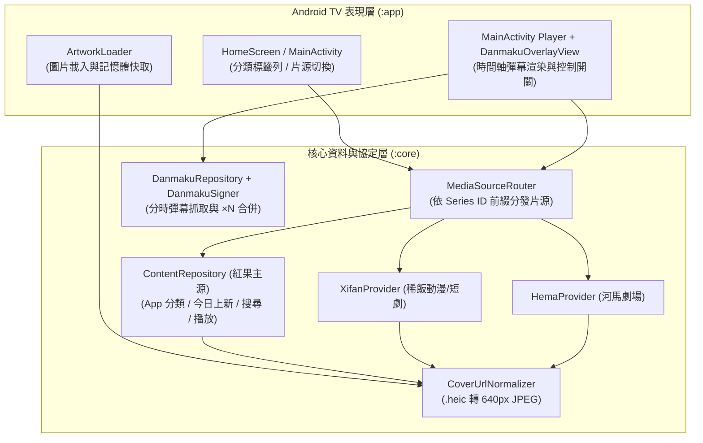

# 宏果tv (Kotlin TV) 四大進階功能系統設計文件 (SDD)

> **文件狀態**：Draft / 待檢閱 (v1.0)
> **更新日期**：2026-11-10
> **目標專案**：`/home/lxon/Documents/Obsidian-Me/hongguoTV` (`com.hongguotv.nativeapp`)
> **借鏡來源**：`jackotom/hongguo-drama` (v6.5)

---

## 1. 背景與設計目標 (Overview & Goals)

本設計文件針對 `jackotom/hongguo-drama` (v6.5) 專案中具備高價值且適合 Android TV 大螢幕與遙控器（D-pad）操作體驗的 4 項功能進行架構轉換與防禦性設計：

1. **Feature #1：題材分類篩選與「今日上新」專區（App 原生分類目錄與標籤篩選）**
2. **Feature #2：海報圖片 `.heic` 轉公開 `640px` JPEG 防破圖與省記憶體**
3. **Feature #4：播放器「官方時間軸彈幕」開關與重複彈幕合併（`× N`）**
4. **Feature #5：多平台片源擴充架構（稀飯動漫 `Xifan` / 河馬劇場 `Hema` / `DramaBox`）**

### 核心設計原則
- **零外部重型依賴**：維持純 Kotlin + Android 原生 View / Canvas + OkHttp + Media3 架構，不引入第三方圖片框架或 WebView。
- **低配電視硬體友善**：嚴格限制記憶體配置（海報降採樣、彈幕單集上限與物件池重用），確保在 1GB/2GB RAM 的 Android 8.0+ 電視盒上維持 60fps 流暢度。
- **防禦性降級（Graceful Degradation）**：任何非核心功能（如彈幕接口、外部片源、App 分類接口）發生網路逾時或上游改版時，絕不崩潰或阻斷主播放流程。

---

## 2. 系統架構總覽 (System Architecture)

---

## 3. 各功能模組詳細設計 (Detailed Module Design)

### 3.1 Feature #2：海報圖片 `.heic` 轉公開 JPEG 防破圖（優先底層基建）

#### 問題分析
紅果 App 原生接口（搜尋 `search/tab/v`、分類 `category/landpage/v/`）回傳的 `cover` 經常是 `https://p3-novel.byteimg.com/novel-pic/...~tplv-resize:300:0.heic` 或 `fqnovelpic.com` 的 `.heic` 檔案。Android 8/9 電視盒缺乏系統級 HEIC 硬體解碼器，或者原圖尺寸過大，容易造成 `BitmapFactory.decodeByteArray` 返回 `null`（黑框破圖）或觸發 OOM。

#### 解決方案
在 [`ContentRepository.kt`](file:///home/lxon/Documents/Obsidian-Me/hongguoTV/kotlin-tv/core/src/main/kotlin/com/hongguotv/core/ContentRepository.kt) 的 `cleanUrl()`（或獨立函式 `normalizeCoverUrl(raw: String): String`）實作轉換規則：
1. 先經過既有 `cleanUrl()` 處理跳脫字元。
2. 檢查 URI Path 是否以 `.heic`（不分大小寫）結尾。
3. 驗證 Host 是否屬於 `byteimg.com` 或 `fqnovelpic.com`，且 Path 以 `/novel-pic/` 開頭並包含 `~` 模板符號。
4. 擷取 `~` 之前的 Object Key，重組為公開免簽章的 JPEG 縮圖直連網址：
   `https://p3-novel.byteimg.com${pathBeforeTilde}~tplv-shrink:640:0.image`
5. 若不符合上述安全網域或格式，保留原網址（或若為無效協定則回傳空字串）。

---

### 3.2 Feature #1：題材分類篩選與「今日上新」專區

#### 接口與協定設計
對接紅果 App 端分類接口：
- **Endpoint**：`POST https://api5-normal-lf.fqnovel.com/reading/distribution/category/landpage/v/`（備援 `api5-normal-lq.fqnovel.com`）
- **簽章方式**：複用 [`Signer.kt`](file:///home/lxon/Documents/Obsidian-Me/hongguoTV/kotlin-tv/core/src/main/kotlin/com/hongguotv/core/Signer.kt) 的 `signer.sign(url, profile, payload)`，其中設備版本號固定帶入 `73532`（`version_name = "7.3.5.32"`）。
- **Request Payload (JSON)**：
  - 漫劇分類：`{"FirstEnter":1,"category_Request_scene":"comic_series","genre_type":"comic_series","offset":0,"page_Nil":false,"select_items":[]}`
  - 真人短劇分類：`{"FirstEnter":1,"category_Request_scene":"default","genre_type":"short_play","offset":0,"page_Nil":false,"select_items":[]}`
  - AI 劇分類：`{"FirstEnter":1,"category_Request_scene":"ai_series","genre_type":"ai_series","offset":0,"page_Nil":false,"select_items":[]}`
  - 當使用者選擇特定題材標籤（如 `cate_12` 玄幻）或「今日上新」時，`select_items` 帶入對應篩選條件；翻頁時帶入上一頁回傳的 `next_offset` 與 `session_id`。

#### 資料模型 (`:core`)
- `data class GenreFilter(val id: String, val label: String)`
  - 預設第一顆固定為 `GenreFilter("", "全部推荐")` 與 `GenreFilter("new_today", "今日上新")`，其餘由接口回傳的 `selector_rows`（`type == "category_dim_theme"`）動態解析（格式校验 `^cate_\d{1,8}$`）。
- 擴充 `CatalogPage`：
  - 新增 `val genres: List<GenreFilter> = emptyList()`。
- 擴充 `Series`：
  - 若 `tag_info.text == "新剧"` 或 `sub_title_list` 含 `"今日上新"`，在 `badge` 顯示 `今日上新 · 全 X 集`。

#### 電視遙控器 UI 互動 (`:app`)
- 在首頁（推薦頁）或分類列上方新增一行水平捲動的「題材膠囊列（Genre Pills）」。
- 遙控器焦點從頂部導覽列按 `↓` 先進入「題材膠囊列」，左右鍵切換題材（確認後重新載入該題材第 1 頁），再按 `↓` 進入劇集海報網格。
- 若 App 分類接口因網路異常失敗，自動無縫退回原本的官網 SSR 榜單（`comicRanking` / `home`），保證首頁永遠有內容。

---

### 3.3 Feature #4：播放時「官方時間軸彈幕」開關與重複合併

#### 接口與協定設計
- **Endpoint**：`POST https://api5-normal-sinfonlineb.fqnovel.com/novel/commentapi/comment/list/{vid}/v1/`（備援 `api5-normal-lf.fqnovel.com`）
- **回傳結構**：每筆彈幕含 `text`（內容）與 `offset_time`（相對於本集開頭的毫秒數）。
- **防禦與邊界限制**：
  - 單集最多拉取前 3 頁（每頁 90 筆，上限 270 筆），避免長篇劇集拉取數千筆造成電視網路與記憶體負擔。
  - 過濾超過 100 字元的異常長文與空白內容。
  - **重複彈幕合併（v6.5 特性）**：在時間軸相近視窗（例如前後 8 秒內）或整集完全相同的彈幕文字（正規化空白與標點後相同），合併為單一彈幕項目並標記 `count`，畫面顯示為 `前方高能 × 5`，大幅減少電視畫面遮擋。

#### 電視端渲染與開關 (`:app`)
- **UI 控制**：
  - 在播放器按 `↑` 呼出的控制列中，新增一顆切換按鈕：`弹幕：关` / `弹幕：开`（狀態持久化於 [`Library.kt`](file:///home/lxon/Documents/Obsidian-Me/hongguoTV/kotlin-tv/app/src/main/kotlin/com/hongguotv/nativeapp/Library.kt)，預設為 **`false` 關閉**，不干擾不愛看彈幕的家人）。
- **輕量級 `DanmakuOverlayView`**：
  - 繼承自 `android.view.View`，疊加於 `PlayerView` 之上、`hud` 控制層之下。
  - 僅使用螢幕上方 **25% 區域（最多 3 條軌道）** 繪製半透明描邊文字（字體大小 `16sp`，透明度 `80%`），確保不遮擋演員臉部與底部字幕。
  - 綁定 ExoPlayer 的播放狀態：暫停時彈幕同步暫停，快轉 / 倒退（Seek）時自動重設時間軸游標，切集時自動清空並載入下一集彈幕。
  - **錯誤靜默處理**：若彈幕接口失敗或逾時，僅在背景略過，**絕不跳出錯誤彈窗或影響影片播放**。

---

### 3.4 Feature #5：多平台片源擴充架構（稀飯動漫 `Xifan` / 河馬劇場 `Hema`）

#### 架構隔離與 ID 命名空間
為了讓收藏夾（Favorites）、觀看歷史（WatchProgress）與主畫面完全相容多片源，且**不破壞既有紅果劇集資料**：
- **ID 命名空間（Namespace）**：
  - 紅果主源（預設）：維持純數字字串 `^[0-9]{1,30}$`（例如 `"7704236550736858174"`），100% 向下相容既有 `native-library-v1` 紀錄。
  - 稀飯動漫 / 短劇（`Xifan`）：使用 `"xifan:{source}:{duanjuId}"`（分集 ID 為 `"xifan:{source}:{duanjuId}:{episodeId}"`）。
  - 河馬劇場（`Hema`）：使用 `"hema:{bookId}"`（分集 ID 為 `"hema:{bookId}:{chapterId}"`）。
- **片源路由器 `MediaSourceRouter` (`:core`)**：
  - 定義統一介面 `CatalogProvider`：
    - `fun home(page: Int, type: ContentType, genre: String = ""): CatalogPage`
    - `fun search(keyword: String, page: Int, type: ContentType): CatalogPage`
    - `fun detail(id: String): Detail`
    - `fun stream(id: String, maxQuality: Int): StreamInfo`
  - 當傳入的 `id` 無冒號時路由至 `ContentRepository`（紅果）；以 `"xifan:"` 開頭路由至 `XifanRepository`；以 `"hema:"` 開頭路由至 `HemaRepository`。
- **安全防護（Media URL Guard）**：
  - 外部片源回傳的播放地址必須強制為 `https://`，禁止包含帳密（`userInfo`），且只允許未加密的標準 MP4 / HLS 直連串流。
  - 鎖定付費集（`locked == true`）在選集面板標示鎖頭並禁止點擊播放，不播放 15 秒試看片花以免誤導家人。

---

## 4. 向下相容與還原方案 (Backward Compatibility & Rollback)

1. **資料相容性**：
   - `Library.kt` 僅新增偏好設定欄位（`danmakuEnabled: Boolean = false`、`activeSource: String = "hongguo"`），既有收藏、歷史紀錄、設備註冊資訊結構完全不變。
2. **一鍵還原方案**：
   - 所有新增功能皆有獨立開關（彈幕預設關閉、外部片源預設紅果、App 分類失敗自動退回官網 SSR）。
   - 若需回退程式碼，可隨時透過 Git 標籤 `git checkout v0.9.08` 還原並重新建置。
